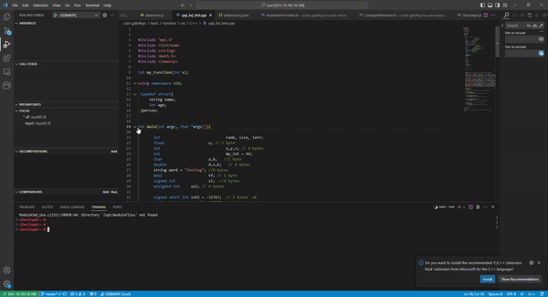
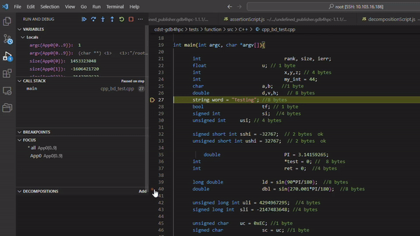
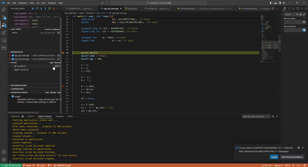
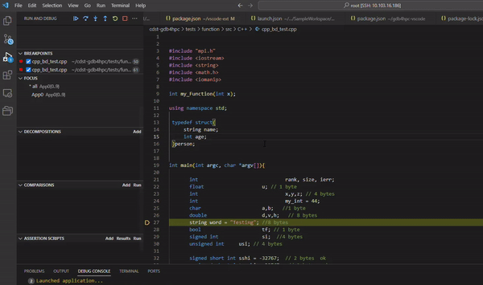
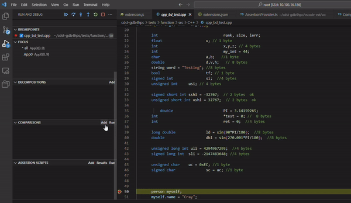
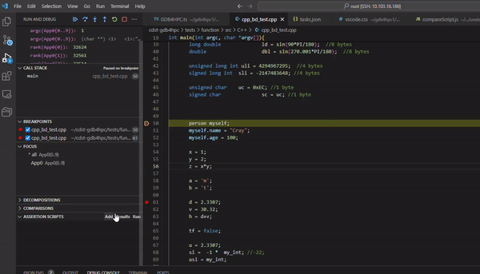

# Installing the GDB4HPC VSCode Plugin
1. Log into the desired machine in vscode.
2. Open the Extensions panel on the left.
3. In the search bar, search for "GDB4HPC" and install
5. The VSCode window might need to be reloaded once the extension is installed.

# Running GDB4HPC debugger in VSCode
A launch.json file is needed. If it does not exist, create a launch.json file and copy the template below and modify as necessary.
```
{
    "version": "1.1.1",
    "configurations": [
        {
            "type": "gdb4hpc",
            "request": "launch",
            "name": "GDB4HPC",
            "dbgversion": "",   
            "apps": [
                {
                    "procset": "",
                    "program": "",
                    "args": ""
                }
            ],
            "cwd": "", 
            "env": {

            },
        }
    ]
}

```

- dbgversion = path to gdb4hpc
- procset = name and ranks for launch command i.e. "App0{10}"
- program = path of program to debug
- args = arg flags for launch command i.e "--gpu --non-mpi"
- cwd = current working directory
- env = list of any env varibales to apply. List them in this format:
```
{
    "GDB4HPC_DEBUG_INTERPRETER": "1",
    "CRAY_DBG_LOG_DIR": "."
}
```

# Display

Open the Run and Debug panel on the left. Choose GDB4HPC in the Dropdown on the top of the panel. If GDB4HPC does not show up as an option, the extension is not installed properly or the launch.json file is not configured correctly.

## Run and Debug
Configure the launch options in the launch.json file before running the debugger. Press the green play button on the left of "GDB4HPC" to launch the debugger session. Once launched, this will be replaced by the pause, step, continue, next, and stop buttons.

  

## Consoles
Different terminals are available on the bottom.

### Debug Console
The Debug Console is the output console for GDB4HPC. Any information and warnings will show up here.

### Output
There is a drop down on the right to choose the Output Channel to view.
**Program Output** will automatically become displayed whenever the application running produces output.
**Error Log** will log all errors while the session is running. Errors also get displayed in a popup as they appear.

## Source Code Display
The screen displays the source code automatically when launched. The current line in the file will be highlighted. You can interact with the source code 
to set breakpoints and get current variable values by hovering. 

## Left Side Panel
The left side panel provides extra ways to interact with the gui. 
Each section of this panel is described below.

### Variables
Local variables and their values will appear here. If the value is different for different ranks it will show up as a separate field here.  

### Watch
In this section, add a custom variable or expression to track.

### Call Stack
Stack information is displayed including the threads and their current status. The current thread is marked with a **selected** label.

### Breakpoints
To set a breakpoint, you can click on the line number that you would like to break on in the source code panel and you can delete it by pressing on the line number again. 

After a breakpoint is created, it will be displayed under the **breakpoint** section of on the left side.
You can enable, disable, and delete each breakpoint here.

  

### Focus
This section allows you to see the lists of pe sets. The pe set in focus is marked as with *. Choose a different pe set to focus on by pressing the **select** button. A new tab can be opened for each pe set describing an individual application. This new tab will display the source code location for the specific pe set as well as any other information specific to that pe set.

  

### Decompositions
To create a decomposition, click the add button in the Decomposition section. This will make a popup appear on the top of the screen. 
In the pop-up enter a name for the decomposition (i.e. $decomp1) or a full decomposition command (i.e. $decomp1 10/2). If you enter in a command, the decomposition will be added to the decomposition section.
If you enter just a name for the decomposition, a new popup will appear to add a decomposition subcommand. This popup will continue to reappear until it is dismissed. When the popup is dissmised, the decomposition will be saved and shown int the decomposition section. 

  

### Compare
To add a comparison, click on the add button in the comparison section. This will make a popup appear on the top of the screen where a comparison is inputted. Press enter to dismiss the popup and save the comparison.
 
When you click the **Compare** button, all of the comparisons in the list that are enabled will be run. Toggle a comparison off if you do not wish to run it.  

  

### Assertion Scripts
To add an assertion, click the add button in the Assertion section. This will make a popup appear on the top of the screen. Follow the instructions on creating the assertion script in the popup. 
Once a name and stop on error have been set, assertions can continue to be added until the popup is dismissed. Dismissing the popup will save the assertion script.

Choose an assertion script from the list to run by selecting its radio button. Then click the **Run** button. Once it is done running, click on the **Results** button.
This will update the display with the results of the run.  

  