# devops-changelog

 

<B>Overall Release Notes Workflow Flowchart</B>

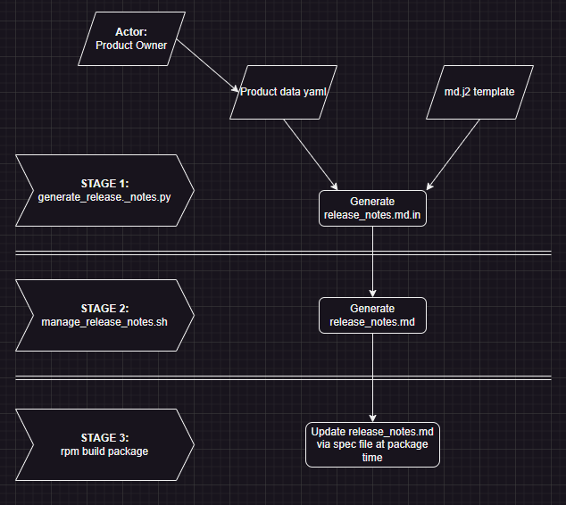

 

----------------------------------------------------------------------

<B>Overview of workflow: Stages 1 - 3</B>

----------------------------------------------------------------------

### STAGE 1: 
################### \
  Includes the generation of the release_notes.md.in:
  
  * Dependencies:
    1. python3-pip
    2. jinja  (specified by requirements.txt)
    3. pyyaml (specified by requirements.txt)
 
  * Inputs:
    1. release-notes-template.md.j2:  \
       This template file specifies the format for the release_notes.md.in file. \
       Source: Located in github changelog

    2. release_notes_data.yaml: \
       This file is maintained by each Product owner to be updated with each release \
       for new/updated release related information which cannot be harvested by the \
       github changelog history. \
       Source: The location where release_nodes_data.yaml is stored.
               e.g: rpmbuild/SOURCES/release_notes_data.yaml

  * Output:
    1. release_notes.md.in \
       Destination: rpmbuild/SOURCES/

### STAGE 2:
################### \
  Includes the generation of the changelog and updated release_notes file.

  * Dependencies:
    1. rust
    2. git-cliff

  * Inputs:
    1. github changelog history
    2. release_notes.md.in

  * Outputs:
    1. release_notes.md \
       Destination: rpmbuild/SOURCES/

### STAGE 3:
################### \
  Includes spec file dynamic update of release_notes.md with release related information at package time.

  Fields for dynamic update:
  - \<NAME>
  - \<VERSION>
  - \<RELEASE_DATE>
  - \<COPYRIGHT>
  - \<ATTRIBUTIONS_FILE_PATH>
  - \<VERSION>
  - \<RELEASE>
  - \<ARCH>

----------------------------------------------------------------------

<B>Detailed info - Stage 2</B>

----------------------------------------------------------------------

### STAGE 2:

This changelog utilizes open source git-cliff changelog tool. \
https://www.opensourceagenda.com/projects/git-cliff

#### Dependencies:
################### \
cargo - the rust package manager 

#### Manual installation:
################### \
Install cargo and update rust and use default nightly repo: \
curl --proto '=https' --tlsv1.2 -sSf https://sh.rustup.rs | sh -s -- -y

source $HOME/.cargo/env && rustup default nightly && rustup update

#### Install git-cliff:
################### \
cargo install git-cliff

git-cliff utilizes a template named cliff.toml to specify changelog formatting. \
When generating a new changelog file, the path to the template file must be explicitly specified.

#### Manually generate a new changelog:
################### \
From the product root directory run:

git cliff -c $PWD/external/changelog/cliff.toml 2>&1 | tee $PWD/CHANGELOG.md

This will create a CHANGELOG.md file in the current directory.

After the CHANGELOG.md file has been generated you can add and commit this file to the
github repo.

#### Automatic Installation:
################### \
Automatic installation occurs when runBuildPackage.sh script is run.  It will automatically
install the necessary dependencies if needed, generate a new CHANGELOG.md file and update
the release notes.  The updated release notes will be included in the package.

#### Usage of manage_release_notes.sh script:
################### \
Usage: ./manage_release_notes.sh [ -c (optional ) ] [ -r (optional) ] [ -s  release_count (optional) ] [ -d (optional) ] [-h help ] \
    -c: update changelog \
    -r: update release notes \
    -s: specify number of releases to include \
    -d: debug mode - print stages to stdout \
    -h: help

To utilize the manage_release_notes.sh script to generate a new changelog file and update release notes: \
source ./external/changelog/manage_release_notes.sh -c -r

The script copies the release_info.template.in into release_info.template and updates it with \
the changelog history.

**NOTE:**  The release notes will include the latest 3 releases by default.  You can specify \
           a different number of releases into the release notes by specifying the following:  \
           '-s 5' will include the latest 5 releases.

----------------------------------------------------------------------

<B>GIT commit message requirements:</B>

----------------------------------------------------------------------

Git commit messages do NOT require a prepended label. \
If you prepend a label listed below onto a git commit message, it will show up in the changelog, otherwise it will not.

#### GIT COMMIT LABELS for PR's ONLY:
1.  feat:     Adding a feature
2.  Feat:     Allowable variation of feature
3.  feature:  Allowable variation of feature
4.  Feature:  Allowable variation of feature
3.  fix:      Adding a fix
4.  Fix:      Allowable variation of fix
5.  bugfix:   Allowable variation of fix
6.  Bugfix:   Allowable variation of fix

Format for Git PR confirm commit: \
Header  \
--------- \
Label: Jira Ticket: Message \
feat: PE-12345: Provided changelog functionality to auto-gen release notes \
Fix: PE-12345 : Fixed a feature that provides this functionality

The commit template follows the Conventional Commits 1.0.0 "standard":
https://www.conventionalcommits.org/en/v1.0.0/

If a commit has been submitted without the label, the commit message will not show up \
in the CHANGELOG.md file. As a result, then will not show up in the release notes.  

#### MERGE REQUIREMENT:
################### \
Comments must be provided with all merges.  Merges will show up in the CHANGELOG.md file,
but will not look correct if no commit message was provided.  

Merge without commit message as shown in the CHANGELOG.md: \
[1f936df]

When a commit message is not provided on a merge, I've specified in the cliff.toml to list as follows: \
- Generic Fix - [1f936df]

To provide a merge message on the cli e.g. : \
git merge -m "feat: PE-12345: Concise but detailed message about overall changes" master

To provide a merge message in GitHub e.g. : \
feat: PE-12345: Concise but detailed message about overall changes

#### MORE ABOUT GIT MERGES: SQUASH
################### \
When merging into master, if there are > 1 commits in the PR: Always squash and merge the commits into 1 commit. 
This ensures for a clean merge history, and its easier to track.

#### PR Merge Process:
###################

#### STEP 1:

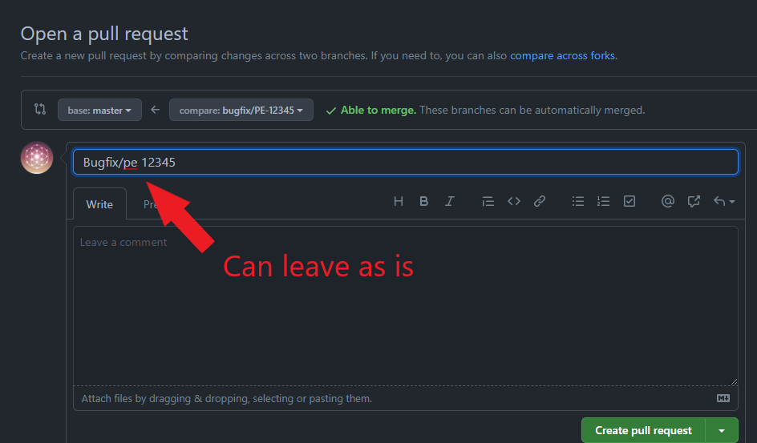

#### STEP 2:

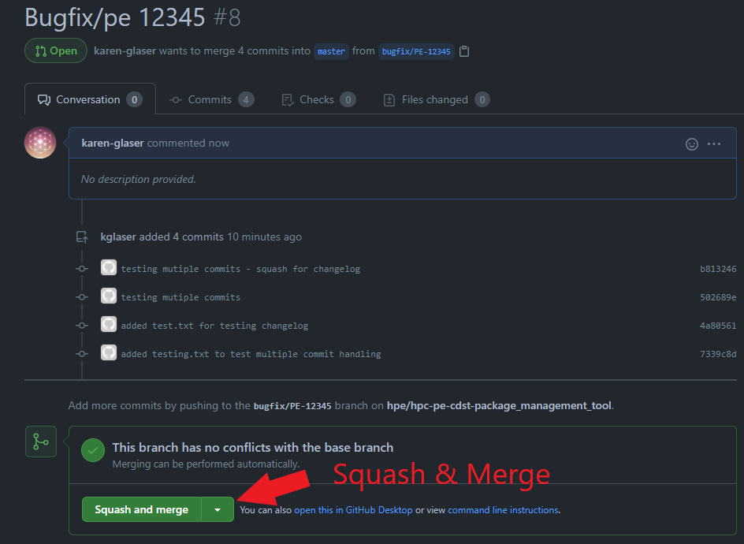

#### STEP 3:

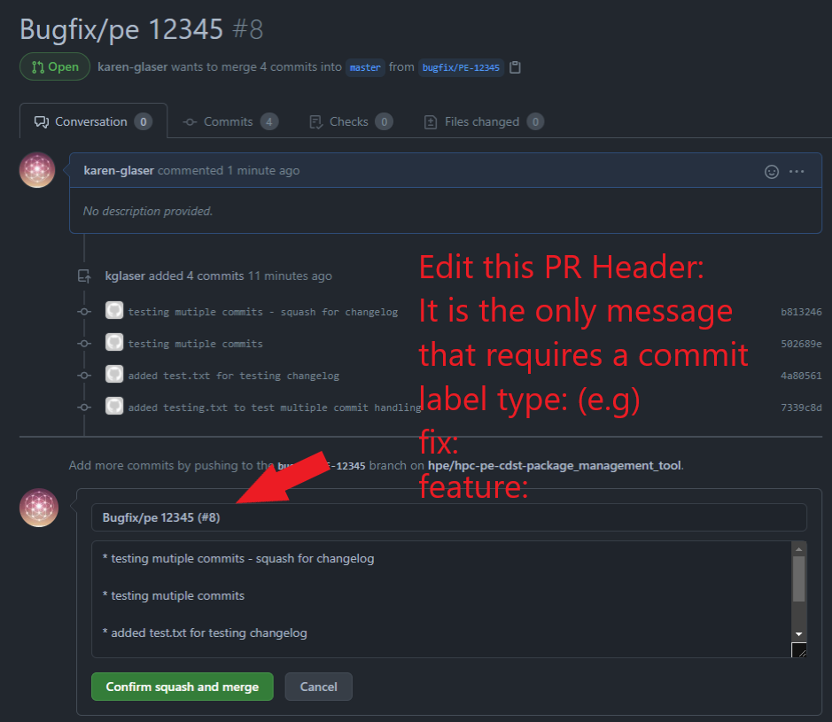

#### STEP 4:

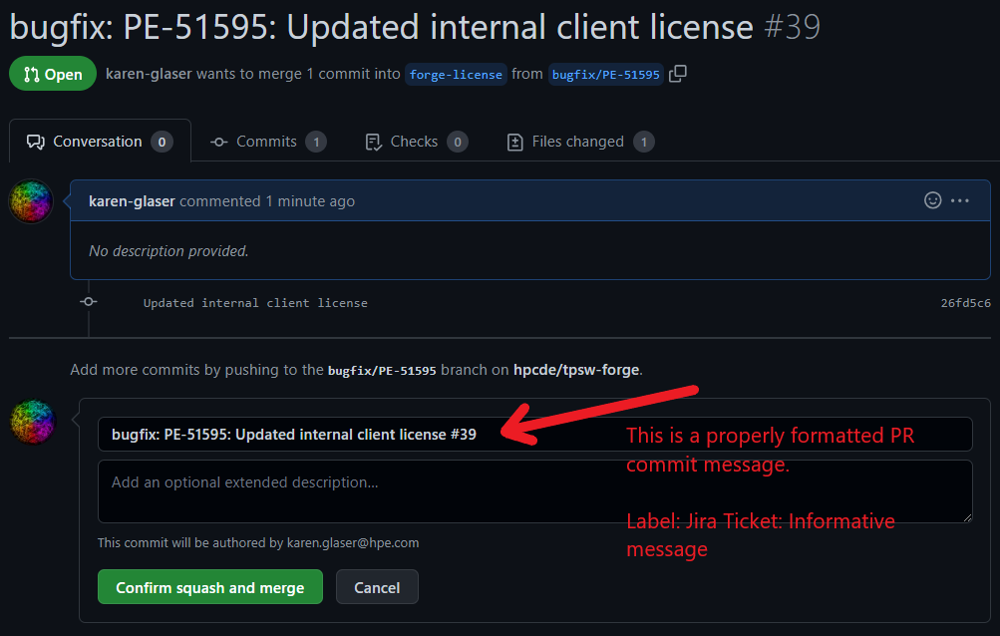

#### COMPLETE:

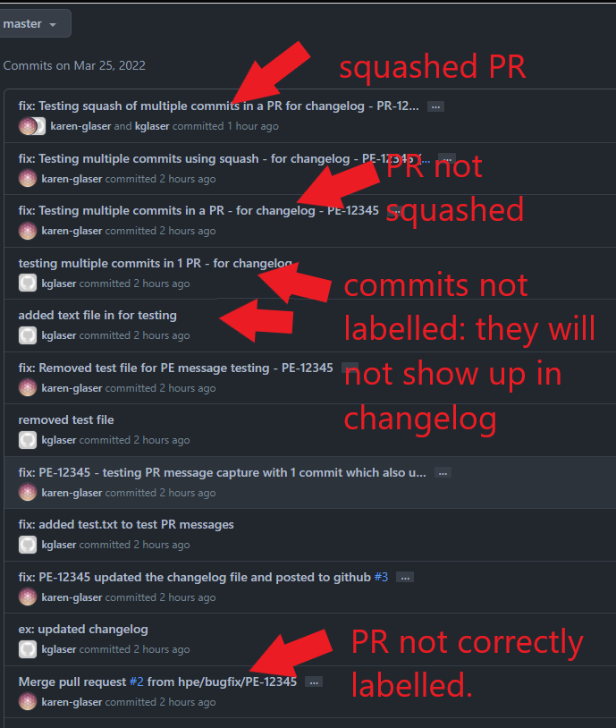

---------------------------------------------------------

<B>Release Management</B>

---------------------------------------------------------

In order for the changelog tool to pick up and properly organize release related information,
you must create github releases, tag the release, and branch for release on that tag.

**Note:** At time of release the following must be done in the products github repo:

  **Process to create a new Release:**
  1. Create a release:
     1. Select 'Releases' located in the far right column on the Code tab
     2. Select 'Draft a new release'
     3. Select 'Choose a tag' from the dropdown list \
        create at tag for the release: name must be prepended by a 'v' - e.g.: v2.18.4 \
        create new tag: on publish
     4. Select the Target from which to create the tag. For initial creation this would most likely by master. 
        
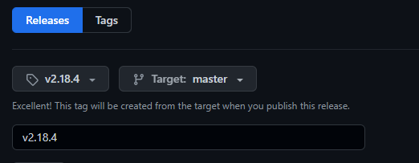

        Note that you can also target a specific commit if needed. 
     5. Enter the name of the Release in the textbox. Naming convention matches the tag: v2.18.4
     6. You can enter any information in the description box that you wish. Note that this information \
        will not be used in the actual release notes for the product.
     6. Select 'Publish release' button

  2. Branch for release: Naming convention for DE: release/pe-23.05 from tag you just created

**Note:** If more commits are made to the release branch after creating the release, this must be \
          redone to properly be picked up and displayed in the release notes. \

  **Process to recreate a new Release:** 
  1. Delete the release.
     1. Select Releases in your GitHub Project (on the far right). 
        
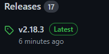

     2. The Release page will display a list of releases. Select the trash can icon
        on the far right of the release you want to delete, Select delete. 
        
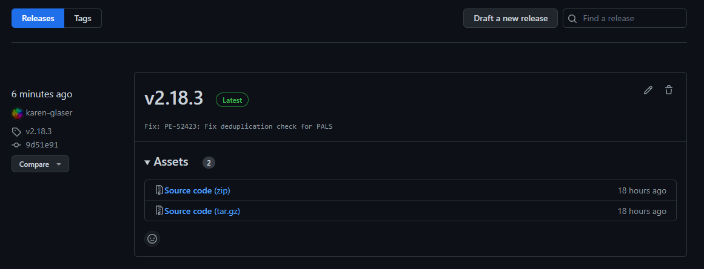

     3. Select yes to confirm deletion.

  2. Delete the tag for that release. 
     1. Select the tags button.
        
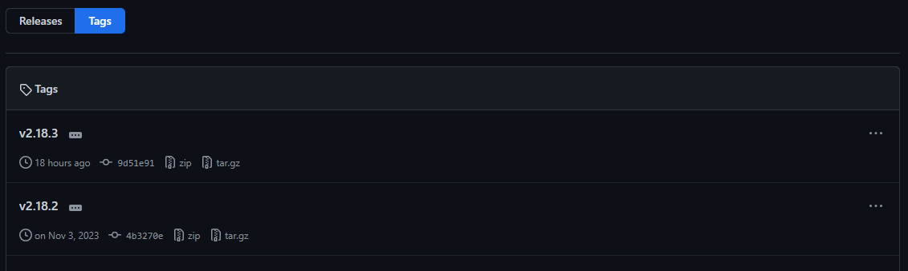

     2. Select the elipses on the far right of the tag you want to delete, Select delete.
     3. Select yes to confirm deletion. 

  3. Create a new release. 
     1. Select 'Releases' in your GitHub Project (on the far right). 
        

     2. On the Releases page, select the 'Draft a new release' button.
        

     3. Select the 'Choose a Tag' button.  Enter the new tag name (e.g. v2.18.3) 
        
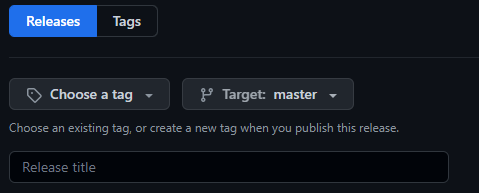

     4. Select the 'Target' drop down button and select the release branch.  (e.g release/pe-24.03) 
        
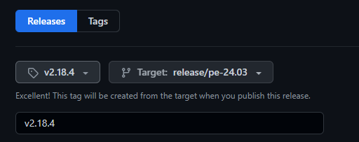

     5. Enter the name of the Release in the textbox.  Named the same as the tag. (e.g. v2.18.3) 
     6. Optionally, you can add any content in the Description box.  NOTE: This will not be used in the \
        generation of the release notes for CPE products. 
     7. Leave the 'Set as the latest release' checkbox checked.  It should be checked by default. 
     8. Select 'Publish release'

----------------------------------------------------------------------

<B>Release Notes Autogen Implementation</B>

----------------------------------------------------------------------

1. The product build needs access to the changelog GitHub repository to utilize the tool:
There are 2 methods:

  1. Include changelog repository into your product as a submodule in external directory:
     1. mkdir external
     2. cd external
     3. git submodule add git@github.hpe.com:hpcde/devops-changlog.git changelog

  2. Clone the repository from your build/packaging scripts:
     1. git clone git@github.hpe.com:hpcde/devops-changlog.git changelog

2. Generate a data yaml containing product specific info.  This file will/may be updated with each release, and will be  consumed by the generate_release_notes.py script to generate the release_notes.md.in.
  
    - To view an example view: https://github.hpe.com/hpcde/devops-changlog/blob/master/examples/release_notes_data.yaml

3. In runBuildPrep.sh 
    - install python3-pip   
   
4. In runBuildPackage.sh (prior to packaging):
    > 1. Generate the release_notes.md.in:
    > 
    >>    pip install -r external/changelog/requirements.txt 
    >    
    >>    rpmbuilddir=$PWD/rpmbuild

    >>    /usr/bin/python3 ./external/changelog/generate_release_notes.py \
    >>    -t $PWD/external/changelog/release-notes-template.md.j2 \
    >>    -y ${rpmbuilddir}/SOURCES/release_notes_data.yaml \
    >>    -d ${rpmbuilddir}/SOURCES
    >  
    >>    usage: generate_release_notes.py [-h] -t TEMPLATE_FILE -y YAML_DATA_FILE [-d DEST_DIR]
    >
    >>     optional arguments: 
    >>     -h, --help            show this help message and exit 
    >>     -t TEMPLATE_FILE,     --template_file TEMPLATE_FILE 
    >>                           Jinja2 template file for release notes 
    >>     -y YAML_DATA_FILE,    --yaml_data_file YAML_DATA_FILE 
    >>                           YAML data file for release notes 
    >>     -d DEST_DIR,          --dest_dir DEST_DIR 
    >>                           Dir to put new release note .md file
    >
    >
    >    **NOTE:** The generate_release_notes.py script consumes product specific data located in \
    >              release_notes_data.yaml in the template format specified by release-notes-template.md.j2 \
    >              and saves the release_notes.md.in in the destination directory specified by -d DEST_DIR. 
    >
    > 2. Generate changelog and release_notes.md: \
    >
    >>   source ./external/changelog/manage_release_notes.sh -c -r 
    >    
    >    **NOTE:** The default source directory for the release_notes.md.in is rpmbuild/SOURCES \
    >              To specify an alternate source directory: \
    >              -s relative_path_to_source_dir
    > 
    >>             Usage: ./manage_release_notes.sh [ -c ] [ -r] [ -s source_dir (optional) ] \
    >>                    [ -n  release_count (optional) ] [ -d (optional) ] [-h help ] \
    >>                    -c: update changelog \
    >>                    -r: update release notes \
    >>                    -s: release_notes source directory \
    >>                    -n: number of releases to include - release count \
    >>                    -d: debug mode - print stages to stdout \
    >>                    -h: help
    >>
    >
    >    **NOTE:**  The release notes will include the current release and the previous 3 releases by default.  \
    >               You can specify a different number of releases to go into the release notes by specifying \
    >               the following:  \
    >               '-n 5' will include the latest 5 releases.
    > 

5. Modify the spec file to:

   1. Update release related info in release_notes.md \
      e.g:
      - \<NAME>
      - \<VERSION>
      - \<RELEASE_DATE>
      - \<COPYRIGHT>
      - \<ATTRIBUTIONS_FILE_PATH>
      - \<VERSION>
      - \<RELEASE>
      - \<ARCH>

         **NOTE:** The variables specified in the release_notes_data.yaml are not strict. \
                   You can specify any variables you want.
   3. Include release_notes.md in the package in the %files section.

6. Update the product modulefile(s) (tcl & lua) to print release_notes.md for module help to work.
  
7. In runInstallTest.sh:
   1. Install your product

   2. Print the release notes
      >
      > if [ -f $install_dir/release_notes.md ]; then \
      >>   cat $install_dir/release_notes.md

8. Ensure that with each release, someone is reviewing the Release Notes to ensure correctness.

---------------------------------------------------------
To Be Determined . . .
---------------------------------------------------------
- [ ] Would it be beneficial to place the OS Dependencies section into the changelog template? \
      * It would ensure consistency across all products. \
      * What about products that may not yet support that dependency?
        Update: At least 1 group suggested that it would be good to allow each group be able to \
                control this.

- [X] Is there a way to ignore a commit that has been commented incorrectly, and as a result, been \
      pulled into the release notes changelog?
      
      You can edit commit messages.  Modify the message to prepend with ex:  or any other text not \
      starting with the supported changelog labels.

- [ ] A lot of people dont view jenkins builds.  I there a way to provide a cat of the release notes \
      for content and format validation?
 
      - Auto emailer?  If so:
      1. On what event trigger with the release notes be emailed?
      2. To whom will it be emailed?

- [X] Can the tool handle a multiline commit message?  

      - The actual message that is inserted is the PR Header.  The PR header (Commit summary) ideally \
        contain fewer than 50 characters.  This is the content that will be pulled into the release notes. \
        If there is more content you want in your PR commit, insert that content into the externded description.

- [ ] Is is possible to add a pre-commit hook to provide validation for those that do cli PR merges.  \
      Is there a way to provide the hook script(s) in the changelog tool?

- [ ] What naming conventions for tags, Releases, and release branches are being used across CPE groups \
      products?  Will the changelog tool support these varying conventions or will/should all of CPE follow \
      the same convention?
